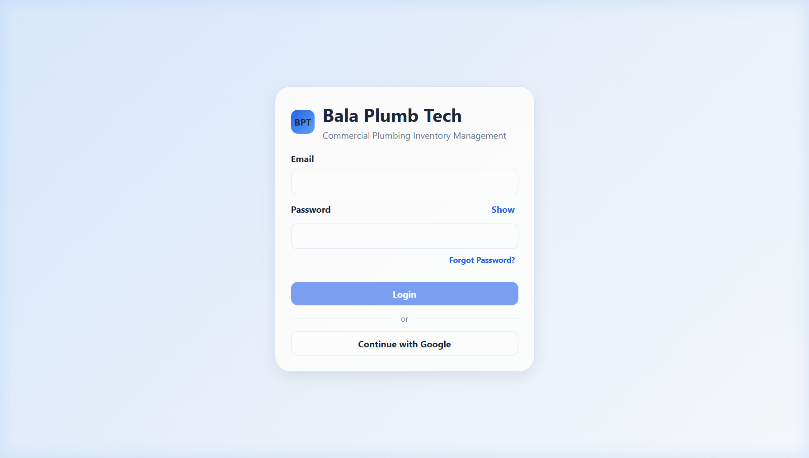
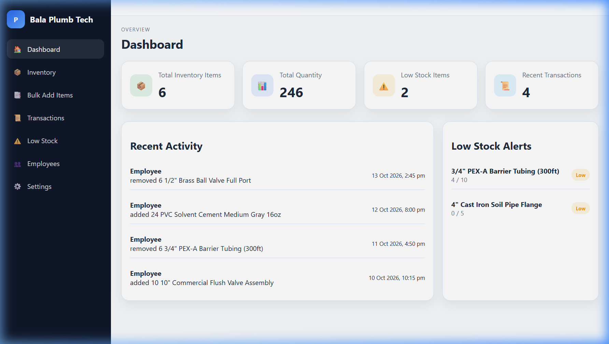
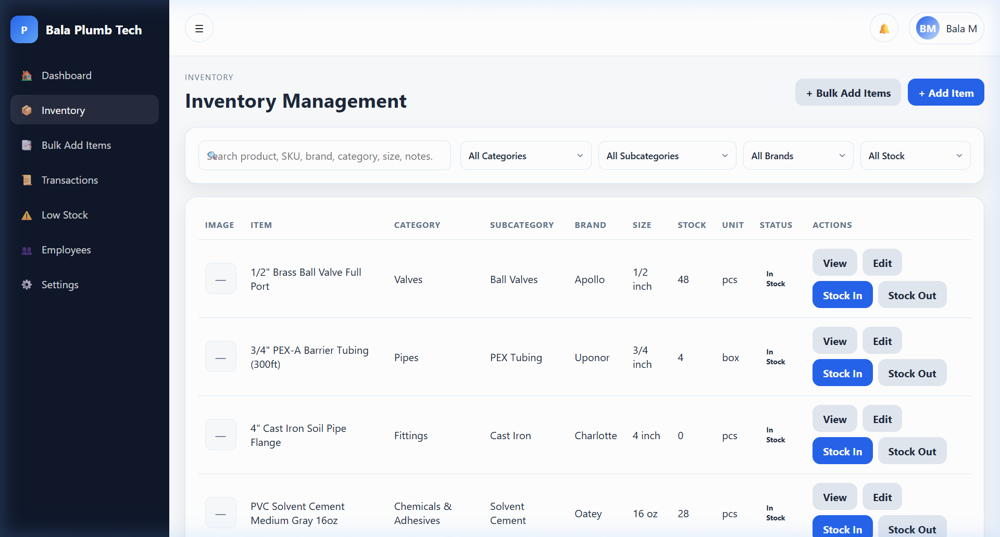
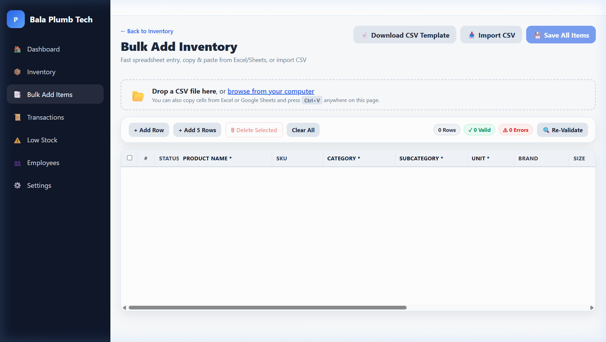
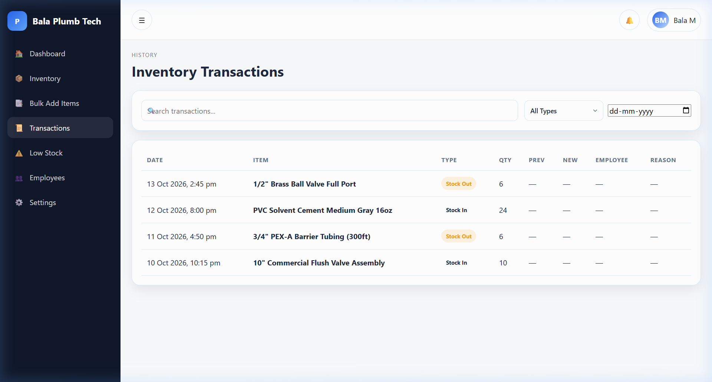
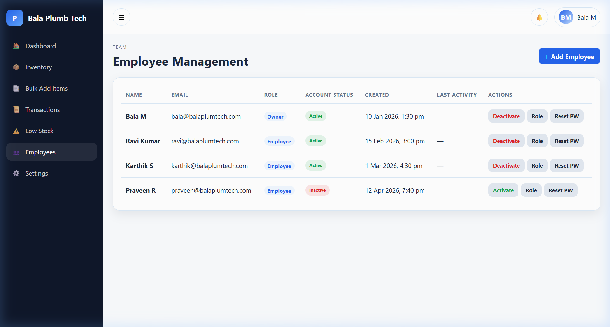
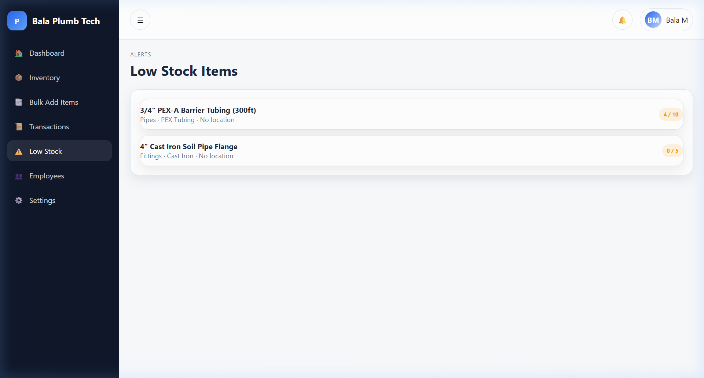

# Bala Plumb Tech

> **Commercial Plumbing Inventory & Stock Management System**<br>
> A lightweight, robust web application designed for plumbing contractors, supply shops, and service teams to track inventory, record stock movements with atomic precision, enforce role-based access, and maintain an immutable audit ledger.

[](https://bala-plum-tech.web.app/)
[](https://developer.mozilla.org/en-US/docs/Web/HTML)
[](https://developer.mozilla.org/en-US/docs/Web/CSS)
[](https://developer.mozilla.org/en-US/docs/Web/JavaScript)
[](https://firebase.google.com/docs/auth)
[](https://firebase.google.com/docs/firestore)
[](https://firebase.google.com/docs/hosting)

---

## Table of Contents

1. [Project Overview](#project-overview)
2. [Application Screenshots](#application-screenshots)
3. [Core Features](#core-features)
4. [Technology Stack](#technology-stack)
5. [Repository Structure](#repository-structure)
6. [Prerequisites](#prerequisites)
7. [Local Setup & Development](#local-setup--development)
8. [Firebase Configuration & Security](#firebase-configuration--security)
9. [Deployment & CI/CD Workflow](#deployment--cicd-workflow)
10. [Firestore Security Rules & Access Control](#firestore-security-rules--access-control)
11. [Troubleshooting Guide](#troubleshooting-guide)
12. [Future Improvements](#future-improvements)
13. [Contributing](#contributing)
14. [License & Contact](#license--contact)

---

## Project Overview

In commercial and residential plumbing operations, inventory leakage, stockouts of critical fittings (e.g., valves, PVC bends, PEX connectors, adhesives), and unlogged job-site material usage lead to costly project delays and billing inaccuracies. **Bala Plumb Tech** solves these operational challenges by providing an intuitive, real-time inventory management platform built directly on modern web standards and Google Firebase.

### Target Personas & Access Roles

The application enforces strict role-based authorization across two distinct personas:

| Role | Target Persona | Responsibilities & Capabilities |
| :--- | :--- | :--- |
| **`OWNER`** | Business Owners & Warehouse Managers | Full administrative authority. Manages inventory items (create, edit, delete), conducts stock movements, views financial/stock valuation metrics, oversees employee accounts (active status & roles), and monitors low-stock alerts. |
| **`EMPLOYEE`** | Field Plumbers & Warehouse Technicians | Everyday inventory operations. Searches catalog items, logs **Stock In** (supplier deliveries) and **Stock Out** (job dispatches) transactions, and views transaction history. Deletion and employee administration rights are restricted. |

### Core Workflows

```
┌────────────────────────────────────────────────────────────────────────┐
│                        Bala Plumb Tech Workflow                        │
└────────────────────────────────────────────────────────────────────────┘
                                    │
           ┌────────────────────────┴────────────────────────┐
           ▼                                                 ▼
   [ OWNER / MANAGER ]                             [ EMPLOYEE / TECH ]
           │                                                 │
   ├─► Manage Employees & Roles                    ├─► Search Catalog & Stocks
   ├─► Catalog CRUD & Deletions                    ├─► Execute Stock In / Out
   ├─► Low-Stock Thresholds & Reports              ├─► Record Job Notes & Reason
   └─► Bulk CSV Import                             └─► View Personal Profile
           │                                                 │
           └────────────────────────┬────────────────────────┘
                                    ▼
           ┌─────────────────────────────────────────────────┐
           │          Cloud Firestore Transactions           │
           │  • Atomic stock balance adjustments             │
           │  • Immutable inventoryTransactions audit log     │
           │  • Real-time low-stock alert triggers           │
           └─────────────────────────────────────────────────┘
```

1. **Inbound & Outbound Movements**: Plumbers record stock adjustments on job dispatch or replenishment. All changes run through atomic Firestore transactions to prevent race conditions.
2. **Category-Driven Cataloging**: Products are categorized using hierarchical plumbing taxonomies (e.g., Pipes & Fittings $\rightarrow$ PVC, CPVC, PEX, Brass) powered by Tom Select search dropdowns.
3. **Proactive Stock Monitoring**: Automated alerts notify staff when quantities drop below minimum reorder thresholds.
4. **Tamper-Proof Audit Trail**: Every stock change creates an append-only transaction record capturing quantity, timestamp, transaction type, reason, and actor UID.

---

## Application Screenshots

> *Note: All screenshots were captured from the running application using sanitized, synthetic demonstration data.*

### 1. Authentication Gateway
Secure sign-in screen supporting Email/Password and Google OAuth authentication with persistent session handling.



---

### 2. Operational Dashboard
Central executive overview displaying key inventory metrics, active low-stock alerts, quick-action shortcuts, and recent transaction feeds.



---

### 3. Inventory Catalog & Filtering
Searchable catalog displaying SKU, brand, category, real-time stock levels, and quick Stock In / Stock Out actions.



---

### 4. Bulk Inventory CSV Import
High-capacity CSV import workflow featuring downloadable sample templates, instant client-side validation, and batched Firestore writes.



---

### 5. Stock Movement Ledger & Audit Trail
Immutable transaction history with granular filtering by date range, transaction type (`STOCK_IN` / `STOCK_OUT`), and keyword.



---

### 6. Employee Management Portal
Owner-only administration console for reviewing registered staff, verifying permissions, and toggling active access statuses.



---

### 7. Low-Stock Monitoring & Reorder List
Filtered operational view isolating all items that have breached or met their minimum stock threshold.



---

## Core Features

- **Authentication & Protected Routing**:
  - Firebase Authentication supporting Email/Password and Google Sign-In.
  - Client-side route guards (`js/auth/route-guard.js`) ensuring unauthenticated users are redirected to `login.html`.
  - Active profile verification: accounts marked `active: false` in Firestore are denied system access.

- **Role-Based Authorization (`OWNER` vs `EMPLOYEE`)**:
  - Dynamic navigation rendering: owner-exclusive modules (such as `employees.html` and item deletion) are automatically hidden from standard staff.
  - Dual-layer enforcement: client-side UI suppression paired with strict Cloud Firestore Security Rules.

- **Comprehensive Inventory Management**:
  - Full CRUD operations with detailed product metadata: Name, SKU, Category, Subcategory, Brand, Size, Unit of Measure (`pcs`, `box`, `m`, `kg`, etc.), Unit Cost, Stock Quantity, and Minimum Stock Threshold.
  - Interactive Tom Select dropdowns providing searchable category cascades with dependent subcategory options.

- **Atomic Stock Movements (Stock In / Stock Out)**:
  - Inventory quantity adjustments are performed inside Firestore transactions (`runTransaction`).
  - **Availability Validation**: Built-in guard checks prevent negative inventory balances during Stock Out operations.
  - Every stock movement records an audit entry capturing reference notes, reason codes, quantity, and operator identity.

- **Bulk CSV Import**:
  - Import dozens or hundreds of plumbing items in one operation via `bulk-inventory.html`.
  - Client-side CSV parsing, header mapping, and row-level validation.
  - Generates downloadable CSV template structures formatted for the application schema.
  - Batched writes (`firestore.batch()`) ensure high performance and data consistency.

- **Employee Access Management**:
  - Owner dashboard (`employees.html`) to view all registered team members.
  - Real-time activation toggles to instantly grant or revoke employee access.

- **Coordinated Application Loading Experience**:
  - Implements an application-wide initialization coordinator (`initCoordinator` in `js/utils/helpers.js`).
  - Synchronizes layout rendering (Navbar, Sidebar, Page Shell) and Firestore data fetching behind a unified loader to eliminate content flashing and layout shifts.
  - Includes robust error boundaries with retry cards if network requests time out.

- **Responsive Mobile-Friendly Layout**:
  - Custom CSS design system (`css/main.css`, `css/responsive.css`) optimized for desktop workstations, warehouse tablets, and field smartphones.

---

## Technology Stack

| Technology | Purpose & Implementation Details |
| :--- | :--- |
| **HTML5** | Semantic structure across all application views (`dashboard.html`, `inventory.html`, etc.). |
| **Vanilla CSS3** | Custom design system using CSS custom properties (variables), Flexbox, CSS Grid, and media queries (`css/main.css`, `css/forms.css`, `css/inventory.css`). No heavy utility frameworks. |
| **Vanilla JavaScript (ES Modules)** | Native browser ES modules (`import`/`export`) providing modular architecture across components, services, and pages. |
| **Firebase Authentication** | User identity management, session tokens, and OAuth credential handling (compat SDK v10.12.2). |
| **Cloud Firestore** | NoSQL document database providing real-time data synchronization, ACID transactions, and offline persistence. |
| **Firebase Hosting** | High-performance static web hosting with global CDN distribution, cache headers, and single-page routing rewrites. |
| **Tom Select** | Lightweight, accessible searchable select dropdowns for category and subcategory filtering. |
| **Node.js (Build & CI Tooling)** | Zero-dependency scripts (`scripts/generate-firebase-config.js`) for local `.env` parsing and automated CI configuration generation. |
| **GitHub Actions** | Automated CI/CD pipeline performing secret-free validation on PRs and manual controlled deployments to Firebase Hosting. |

---

## Repository Structure

```
Bala-Plum-Tech/
├── .github/
│   └── workflows/
│       └── deploy.yml              # GitHub Actions CI validation & deployment workflow
├── assets/
│   └── icons/
│       └── user.png                # Default profile avatar asset
├── css/
│   ├── auth.css                    # Styling for authentication views
│   ├── bulk-inventory.css          # Styling for bulk CSV import interface
│   ├── forms.css                   # Reusable form controls, inputs, and validation styles
│   ├── inventory.css               # Inventory grid, cards, and modal styling
│   ├── main.css                    # Global design tokens, layout, typography, and loaders
│   └── responsive.css             # Breakpoint adaptations for tablets and mobile devices
├── docs/
│   └── screenshots/               # Verified application screenshots for documentation
│       ├── bulk-import.png
│       ├── dashboard.png
│       ├── employee-management.png
│       ├── inventory.png
│       ├── login.png
│       ├── low-stock.png
│       └── transactions.png
├── js/
│   ├── auth/
│   │   ├── auth.js                 # Authentication state listeners and session management
│   │   ├── login.js                # Login page controller (Email & Google sign-in)
│   │   └── route-guard.js          # Route protection and role verification guard
│   ├── components/
│   │   ├── navbar.js               # Top navigation bar component & notifications menu
│   │   └── sidebar.js              # Role-aware sidebar navigation component
│   ├── firebase/
│   │   ├── firebase-config.example.js  # Safe tracked template for client configuration
│   │   └── firebase-config.js      # Generated client configuration (gitignored)
│   ├── pages/
│   │   ├── bulk-inventory.js       # Bulk CSV upload, parsing, and batch commit logic
│   │   ├── dashboard.js            # KPI metrics, low-stock summary, and activity feed
│   │   ├── employees.js            # Employee status and role management (Owner only)
│   │   ├── inventory.js            # Inventory catalog controller & Tom Select dropdowns
│   │   ├── item-details.js         # Single item detail view & stock history
│   │   ├── low-stock.js            # Low-stock monitoring and reorder page
│   │   ├── profile.js              # User profile controller
│   │   ├── settings.js             # Business settings controller
│   │   └── transactions.js         # Stock transaction ledger controller
│   ├── services/
│   │   ├── inventory-service.js    # Firestore CRUD and atomic stock movement transactions
│   │   ├── notification-service.js # User notification dispatch and state handling
│   │   ├── transaction-service.js  # Transaction ledger queries and filtering
│   │   └── user-service.js         # User profile queries and status modifications
│   └── utils/
│       ├── constants.js            # Plumbing categories, subcategories, and unit definitions
│       ├── helpers.js              # initCoordinator, toast alerts, formatting, and modals
│       └── validation.js           # Form input validators and data integrity checks
├── scripts/
│   └── generate-firebase-config.js # Zero-dependency generator for firebase-config.js
├── .env.example                    # Sample environment template (tracked in Git)
├── .firebaserc                     # Firebase project alias configuration
├── .gitignore                      # Git exclusion rules (ignores .env and generated config)
├── bulk-inventory.html             # Bulk inventory CSV import page
├── dashboard.html                  # Executive inventory dashboard page
├── employees.html                  # Employee access management page
├── firebase.json                   # Firebase Hosting and Firestore deployment rules
├── firestore.indexes.json          # Firestore composite indexes definition
├── firestore.rules                 # Cloud Firestore security rules
├── index.html                      # Root entry page (redirects to dashboard or login)
├── inventory.html                  # Main inventory catalog page
├── item-details.html               # Item detail and transaction inspection page
├── login.html                      # Authentication gateway page
├── low-stock.html                  # Dedicated low-stock alerting page
├── profile.html                    # User profile page
├── README.md                       # Project documentation
├── settings.html                   # Application settings page
└── transactions.html               # Stock transaction audit ledger page
```

---

## Prerequisites

Before setting up the project locally, ensure you have the following installed and configured:

1. **Git**: Installed on your operating system for version control.
2. **Node.js (v18.0.0 or higher, v20 recommended)**:
   > *Note: Node.js is utilized solely to run the zero-dependency configuration generator script (`scripts/generate-firebase-config.js`) and run syntax checks. The application frontend itself requires no build step or node runtime.*
3. **A Modern Web Browser**: Google Chrome, Mozilla Firefox, Microsoft Edge, or Safari with native ES module support.
4. **A Google Firebase Project**:
   - Firebase Authentication enabled with **Email/Password** and **Google** providers.
   - Cloud Firestore database provisioned in production mode.
   - Authorized domain configured in Firebase Console (e.g., `localhost`).

---

## Local Setup & Development

Follow these copy-paste-ready instructions to run Bala Plumb Tech on your local workstation.

### Step 1: Clone the Repository

Clone the project from GitHub and navigate into the repository root:

```bash
git clone https://github.com/jaivarshan7/Bala-Plum-Tech.git
cd Bala-Plum-Tech
```

### Step 2: Create the Local Environment File

Copy the provided `.env.example` template to `.env`:

**Windows PowerShell:**
```powershell
Copy-Item .env.example .env
```

**macOS / Linux:**
```bash
cp .env.example .env
```

### Step 3: Populate `.env` with Firebase Credentials

1. Open the [Firebase Console](https://console.firebase.google.com/).
2. Select your project (e.g., `bala-plum-tech`).
3. Click the gear icon $\rightarrow$ **Project settings** $\rightarrow$ **General**.
4. Scroll to **Your apps**, click your web app (`</>`), and locate the `firebaseConfig` object.
5. Open your local `.env` file and populate the corresponding values:

```env
FIREBASE_API_KEY=AIzaSyA1234567890ExampleKey
FIREBASE_AUTH_DOMAIN=bala-plum-tech.firebaseapp.com
FIREBASE_PROJECT_ID=bala-plum-tech
FIREBASE_STORAGE_BUCKET=bala-plum-tech.appspot.com
FIREBASE_MESSAGING_SENDER_ID=123456789012
FIREBASE_APP_ID=1:123456789012:web:abcdef123456
FIREBASE_MEASUREMENT_ID=G-ABCDEF1234
```

> **Security Note:** Never commit your `.env` file to Git. It is excluded by default in `.gitignore`.

### Step 4: Generate the Local Firebase Configuration

Execute the configuration generator script. It reads your `.env` file and outputs `js/firebase/firebase-config.js`:

```bash
node scripts/generate-firebase-config.js
```

**Expected output:**
```text
[SUCCESS] Generated Firebase configuration at: js/firebase/firebase-config.js (configured mode)
```

*(Optional)* If you only wish to test the UI shell without live Firebase credentials, you can generate a placeholder configuration:
```bash
node scripts/generate-firebase-config.js --placeholder
```

### Step 5: Start a Local HTTP Web Server

Because the application uses native browser ES modules (`import`/`export`), pages cannot be opened via `file://` protocol. Start a lightweight local HTTP server:

**Using Python (pre-installed on most systems):**
```bash
python -m http.server 8000
```

**Alternatively, using Node.js `npx serve`:**
```bash
npx -y serve . -p 8000
```

### Step 6: Launch the Application

Open your browser and navigate to:
```text
http://localhost:8000/
```

The application will initialize, check authentication status, and route you to `login.html`.

---

## Firebase Configuration & Security

### Browser Configuration vs. Privileged Secrets

Understanding the separation between client configuration and privileged secrets is critical:

| Credential Type | Example Files | Exposure Level | Security Mechanism |
| :--- | :--- | :--- | :--- |
| **Client Web Config** | `js/firebase/firebase-config.js` | **Public to Browser** | Identifies your Firebase project to the client SDK. **It is not a secret.** Security is enforced by **Firebase Authentication** and **Firestore Security Rules**. |
| **Local Environment** | `.env` | **Strictly Private** | Kept on local developer machines; ignored by Git (`.gitignore`). |
| **Deployment Credentials** | Service Account JSON | **Strictly Private** | Stored securely in GitHub Actions Secrets (`FIREBASE_SERVICE_ACCOUNT_BALA_PLUM_TECH`). Used exclusively by CI runners for deployment. **Never placed in frontend code.** |

### Version Control Best Practices

- `js/firebase/firebase-config.js` is excluded by `.gitignore` to prevent hardcoded configuration from polluting version control.
- `js/firebase/firebase-config.example.js` and `.env.example` are committed as safe, self-documenting templates.
- **Never commit a Google Cloud service account JSON file, Firebase private key, or production `.env` file.**

---

## Deployment & CI/CD Workflow

The repository includes an automated GitHub Actions workflow (`.github/workflows/deploy.yml`) that guarantees secure, deterministic deployments to Firebase Hosting.

### Workflow Architecture

```
Pushes & Pull Requests to 'main'
  │
  └─► Secret-Free CI Validation (Placeholder mode)
      • Generates test config with --placeholder
      • Executes 'node --check' syntax verification
      • Zero secrets exposed or needed

Manual 'workflow_dispatch'
  │
  ├─► [ dry_run: true ]
  │   • Generates real config using GitHub Secrets
  │   • Validates ES module syntax ('node --check')
  │   • Exits cleanly WITHOUT calling Firebase Deploy
  │
  └─► [ dry_run: false ]
      • Generates real config from GitHub Secrets
      • Validates ES module syntax
      • Deploys static assets to Firebase Hosting Live Channel
```

### Required GitHub Actions Secrets

To enable manual deployment, configure the following secrets in **GitHub Repository Settings $\rightarrow$ Secrets and variables $\rightarrow$ Actions**:

1. **Client Web App Configuration (Injected into `firebase-config.js` during build):**
   - `FIREBASE_API_KEY`
   - `FIREBASE_AUTH_DOMAIN`
   - `FIREBASE_PROJECT_ID`
   - `FIREBASE_STORAGE_BUCKET`
   - `FIREBASE_MESSAGING_SENDER_ID`
   - `FIREBASE_APP_ID`
   - `FIREBASE_MEASUREMENT_ID` *(optional)*

2. **Deployment Service Account (Used exclusively by Firebase Deploy Action):**
   - `FIREBASE_SERVICE_ACCOUNT_BALA_PLUM_TECH`: A Google Cloud Service Account JSON key with the **Firebase Hosting Admin** role.

### Executing a Deployment

1. Navigate to **Actions** in your GitHub repository.
2. Select **Deploy to Firebase Hosting** from the workflow list.
3. Click **Run workflow**:
   - For a **pre-deployment test**, leave `Dry run` checked (`dry_run: true`).
   - For a **live deployment**, uncheck `Dry run` (`dry_run: false`).
4. Click **Run workflow**.

---

## Firestore Security Rules & Access Control

All business constraints, role authorizations, and data validation rules are strictly enforced by Cloud Firestore Security Rules (`firestore.rules`).

### Security Rule Highlights

- **Profile-Backed Authentication (`isActiveUser`)**:
  All requests require the user to be authenticated and have an active profile document in `/users/{uid}` with `active == true`. Deactivated employees are blocked instantly at the database layer.

- **Role-Based Permissions**:
  - `isOwner()`: User profile contains `role == 'OWNER'`.
  - `isEmployee()`: User profile contains `role == 'EMPLOYEE'`.
  - `isStaff()`: Either Owner or Employee.

- **Collection Specifications**:

  | Collection | Read Permission | Create Permission | Update Permission | Delete Permission |
  | :--- | :--- | :--- | :--- | :--- |
  | `/users/{userId}` | Signed-in user (self) or Owner | Owner only | Owner, or Self (cannot modify role, active status, or email) | **Disabled** (`false`) |
  | `/inventory/{itemId}` | Active Staff (`isStaff()`) | Active Staff (validated schema) | Active Staff (validated schema) | **Owner Only** (`isOwner()`) |
  | `/inventoryTransactions/{txnId}` | Active Staff (`isStaff()`) | Active Staff (validated schema) | **Disabled** (`false`) | **Disabled** (`false`) |
  | `/notifications/{notifId}` | Recipient or Owner | Active Staff | Recipient or Owner (`isRead` only) | **Disabled** (`false`) |

- **Tamper-Proof Audit Log**:
  `/inventoryTransactions` entries can only be appended (`create`). Updates and deletions are explicitly disallowed (`allow update: false; allow delete: false;`), preserving an unalterable audit trail of every stock adjustment.

- **Data Integrity Constraints**:
  `isValidInventoryItem()` validates that inventory items contain valid name lengths ($\le 200$ chars), non-empty categories, non-negative numbers for `stock`, `minimumStock`, and `unitCost`, and valid image URLs.

---

## Troubleshooting Guide

### 1. `[ERROR] Missing required Firebase configuration values`
- **Cause:** Running `node scripts/generate-firebase-config.js` when `.env` is missing or one of the required keys is empty.
- **Solution:** Verify that `.env` exists in the repository root and contains non-empty values for `FIREBASE_API_KEY`, `FIREBASE_AUTH_DOMAIN`, `FIREBASE_PROJECT_ID`, `FIREBASE_MESSAGING_SENDER_ID`, and `FIREBASE_APP_ID`.

### 2. Browser Console: `Failed to load module script: Expected a JavaScript module` / CORS Errors
- **Cause:** Attempting to open HTML files directly via the browser (`file:///d:/.../index.html`).
- **Solution:** Launch a local HTTP server as described in [Local Setup](#step-5-start-a-local-http-web-server) (`python -m http.server 8000`) and access the app via `http://localhost:8000`.

### 3. `Firebase: Error (auth/unauthorized-domain)`
- **Cause:** The domain hosting your app (e.g., `localhost` or custom domain) is not whitelisted in Firebase Authentication.
- **Solution:** Go to **Firebase Console $\rightarrow$ Authentication $\rightarrow$ Settings $\rightarrow$ Authorized domains** and add `localhost`.

### 4. `FirebaseError: Missing or insufficient permissions`
- **Cause:**
  1. The user account does not have a corresponding document in the `/users` Firestore collection.
  2. The user document has `active: false`.
  3. A non-owner attempted an owner-only action (such as deleting an inventory item or editing employee statuses).
- **Solution:** In the Firestore console, check `/users/{uid}`. Verify the document exists, `active` is set to `true`, and `role` is set to `'OWNER'` or `'EMPLOYEE'`.

### 5. Tom Select Dropdowns Not Loading
- **Cause:** The enhanced category/subcategory dropdowns on `inventory.html` load Tom Select from the jsDelivr CDN.
- **Solution:** Ensure your workstation has internet connectivity. Native HTML selects remain functional as fallbacks if CDN assets are blocked.

### 6. Local Server Port Conflict (`Address already in use`)
- **Cause:** Port 8000 is occupied by another running process.
- **Solution:** Bind to an alternate port, e.g., `python -m http.server 8080`.

---

## Future Improvements

The following items represent planned enhancements for future releases:

- [ ] **Barcode & QR Code Scanner**: Native camera scanning for fast check-in and check-out of plumbing fittings on mobile devices.
- [ ] **Purchase Order Generation**: Automated generation of vendor PO documents when items breach minimum stock levels.
- [ ] **Data Export Capabilities**: Exporting inventory catalogs and transaction audit logs to Excel (.xlsx) and PDF formats.
- [ ] **Multi-Location & Truck Stock Tracking**: Assigning inventory partitions to specific service vans or remote warehouses.
- [ ] **Offline-First Synchronization**: Expanded background sync queues using IndexedDB and Service Workers for field sites with intermittent connectivity.

---

## Contributing

Contributions to improve Bala Plumb Tech are welcome. Please adhere to the following workflow:

1. **Fork or Branch**: Create a feature branch from `main`:
   ```bash
   git checkout -b feature/your-feature-name
   ```
2. **Local Testing & Syntax Checks**:
   - Ensure all JavaScript modules pass node syntax validation:
     ```bash
     node --check js/firebase/firebase-config.example.js
     node scripts/generate-firebase-config.js --placeholder --output js/firebase/firebase-config.test.js
     node --check js/firebase/firebase-config.test.js
     ```
   - Test UI responsiveness and functionality locally.
3. **Commit Cleanly**:
   - Never commit `.env` or generated `js/firebase/firebase-config.js`.
   - Write descriptive commit messages.
4. **Submit a Pull Request**: Provide a clear explanation of changes and verification steps. Pull request CI checks will validate that configuration generators and templates remain clean.

---

## License & Contact

- **License**: No formal open-source license is currently specified. This project is maintained as a commercial plumbing operations starter and inventory management system.
- **Repository**: [https://github.com/jaivarshan7/Bala-Plum-Tech](https://github.com/jaivarshan7/Bala-Plum-Tech)
- **Live Application**: [https://bala-plum-tech.web.app/](https://bala-plum-tech.web.app/)
